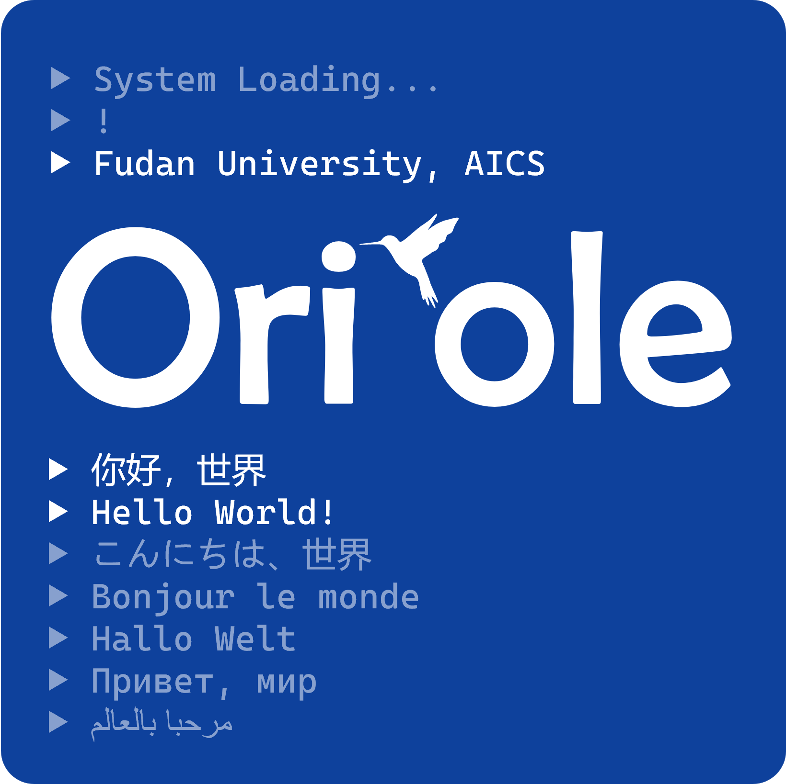

<div align="center">
  
  <h1>WisePen Project (WiseLe)</h1>
  <p><strong>面向高校课程场景的 AI 原生知识基础设施</strong></p>
  <p>
    <a href="docs/getting-started.md">快速开始</a>
    ·
    <a href="docs/README.md">项目文档</a>
    ·
    <a href="docs/submodule-workflow.md">协作流程</a>
    ·
    <a href="CONTRIBUTING.md">参与贡献</a>
  </p>
</div>

[](versions.yaml)
[](#项目状态)
[](LICENSE)
[](wisepen-view)
[](wisepen-cloud)
[](wisepen-cloud-ai)
[](deploy)

WisePen 是面向高校课程场景的课程知识管理与智能学习支持平台，致力于成为高校各类知识的组织、流通与智能应用基础设施。

项目围绕 **课程资源**、**学生笔记** 与 **AI Skill** 三类核心对象展开建设，服务教师的课程组织、资源治理与过程评价需求，也服务学生的资料学习、协同笔记与研写产出需求。

WisePen 由复旦大学计算与智能创新学院 CodeWisdom 实验室发起，Oriole Studio 负责架构设计与核心研发。

## Quick Links

| 入口 | 说明 |
| --- | --- |
| [快速开始](docs/getting-started.md) | 克隆、初始化中间件、启动微服务与本地开发。 |
| [配置说明](docs/config-reference.md) | 环境变量、配置来源、Nacos 与 `.env` 边界。 |
| [部署编排](deploy/README.md) | 中间件、业务种子、profile 与部署目录说明。 |
| [脚本说明](scripts/README.md) | 中间件启停、环境分发、应用构建与部署脚本。 |
| [Submodule 工作流](docs/submodule-workflow.md) | 主仓库与五个子仓库的协作方式。 |
| [贡献指南](CONTRIBUTING.md) | 分支、commit、PR 与平台级版本规则。 |

## Table of Contents

- [核心愿景](#核心愿景)
- [功能特性](#功能特性)
- [用户价值](#用户价值)
- [项目状态](#项目状态)
- [当前阶段](#当前阶段)
- [仓库结构](#仓库结构)
- [技术架构](#技术架构)
- [架构图](#架构图)
- [Screenshots / Demo](#screenshots--demo)
- [快速开始](#快速开始)
- [文档入口](#文档入口)
- [部署与配置边界](#部署与配置边界)
- [路线图](#路线图)
- [Community / Contact](#community--contact)
- [协作与贡献](#协作与贡献)
- [License](#license)

## 核心愿景

高校课程教学中常见的痛点包括：资源分散、知识难沉淀、学习过程不可见、AI 使用缺少课程语境约束、优质学习成果难以复用。WisePen 希望通过统一平台把课程知识、学习过程与智能能力连接起来。

- 建立统一的课程知识资源体系，将文档、笔记与 Skill 纳入同一资源模型进行管理、授权与复用。
- 建立覆盖课前、课中、课后的学习支持链路，将资源阅读、问答、笔记、写作与讨论衔接起来。
- 建立过程可追踪的教学支撑能力，为教师提供基于真实行为数据的过程分析与教学反馈。
- 建立可持续流通的资源生态，为优质笔记、课程资料与可复用的智能能力提供沉淀与激励机制。

## 功能特性

| 能力 | 说明 |
| --- | --- |
| 课程知识库 | 支持围绕课程、章节、专题、教学周次或知识模块组织课程资料。 |
| 统一资源模型 | 将 Note、PDF、Word、PPT、Excel 与后续 Skill 纳入统一管理、授权与复用体系。 |
| 资源权限与保护 | 支持个人 / 组空间隔离、访问控制、下载边界与动态水印预览。 |
| 文档处理链路 | 支持上传初始化、对象存储直传、秒传、状态流转与 PDF 在线预览。 |
| 协同笔记 | 支持多人协同编辑、只读 / 可编辑连接、版本历史、快照与操作日志。 |
| AI Chat | 支持多模型接入、流式对话、会话管理、上下文管理、长期记忆与 Token 统计。 |
| AI Skill 雏形 | 支持 Skill 加载、工具调用和示例任务，为后续 Skill 资源化打底。 |
| 工程治理 | 支持 submodule 聚合、Docker Compose 部署、Nacos 配置、Jenkins 流水线与脚本化环境分发。 |

## 用户价值

### 教师侧

WisePen 面向教师提供课程知识治理、教学组织与过程评价能力。

- 课程知识治理：按课程、章节、专题、教学周次或知识模块组织课件、参考文献、阅读材料、案例资料、作业说明等资源，并设置访问、下载、共享和流转规则。
- 课前教学支持：基于课程资料编制章节大纲、专题思维导图、阅读任务清单，并为课程任务配置专属 AI Skill。
- 课中互动支持：围绕知识点发起问答、收集学生观点、聚类课堂高频疑问，辅助教师判断理解情况并调整讲授节奏。
- 课后教学支持：支持作业发布、答疑辅导、作业过程查看、初步评价、复习题生成与个性化复习建议。
- 过程评价与反馈：通过笔记、讨论、写作、协作和 AI 使用记录，帮助教师理解学生真实学习状态并优化后续教学设计。

### 学生侧

WisePen 面向学生提供资料管理、知识理解、协作研写与问答支持能力。

- 学习资料管理：统一存储和整理课件、论文、阅读材料、课堂笔记、小组资料和往届经验材料。
- AI 辅助阅读：围绕论文、课件、教材、案例、政策文本等资料进行摘要理解、概念解释、结构梳理和重点提取。
- 协同研写：支持课堂笔记、阅读札记、课程作业、小组报告和结课论文等内容生产，并保留修订记录与协作过程。
- 专业问答：同时支持通用知识问答与结合课程资料、教师要求、学科规范和当前任务的课程语境问答。

## 项目状态

WisePen 当前处于 `v0.1.0-dev` 阶段，Q1 平台底座已完成，项目仍在快速迭代中。当前主仓库重点承担平台级集成、部署、文档与版本组合维护职责。

| 项目 | 状态 |
| --- | --- |
| 平台版本 | `v0.1.0-dev`，见 [`versions.yaml`](versions.yaml)。 |
| 当前阶段 | Q1 已完成，Q2 能力建设规划中。 |
| 稳定性 | 适合开发、联调、教学试点与非商业研究场景；尚未声明为通用生产稳定版本。 |
| 许可协议 | Business Source License 1.1，详见 [`LICENSE`](LICENSE)。 |
| 仓库形态 | 主仓库通过 git submodule 聚合五个子仓库。 |

## 当前阶段

Q1 阶段已完成 WisePen 从概念验证到平台底座的建设，形成支撑后续课程知识管理、智能学习支持和资源流通的基础能力。

- 用户、组织与基础计费体系：支持注册登录、邮箱验证、课程组 / 用户组、成员管理、角色配置、Token 钱包、额度管理、充值券与消费记录。
- 课程资源管理与权限体系：支持 Note、PDF、Word、PPT、Excel 等多类资源，以及个人空间、课程组空间、标签树、目录组织和访问控制。
- 文档上传、预览与产权保护：支持对象存储直传、秒传、文档状态流转、PDF 预览和动态水印。
- 笔记与协同研写底座：支持多人协同编辑、编辑房间管理、权限校验、只读 / 可编辑连接、文档快照、版本历史和细粒度操作日志。
- AI Chat 服务与 Skill 雏形：支持多模型接入、流式对话、会话管理、历史消息分页、上下文管理、长期记忆、摘要压缩、Token 统计和示例 Skill。
- 工程与服务治理基础：完成多服务拆分、服务发现、消息事件、容器化部署和持续集成基础。

## 仓库结构

本仓库是 WisePen 平台主仓库，通过 git submodule 聚合五个子仓库。业务代码仍在对应子仓库独立开发、提交和 review；主仓库负责记录平台级集成状态，包括 submodule 指针、部署脚本、文档和发布版本。

| 路径 | 职责 |
| --- | --- |
| `wisepen-view/` | 前端项目，基于 React、Vite、Ant Design 与 BlockNote。 |
| `wisepen-cloud/` | Java 后端微服务，基于 Spring Boot、Spring Cloud Alibaba 与 MyBatis-Plus。 |
| `wisepen-cloud-ai/` | Python AI 服务，承载 AI Chat、Skill 与相关智能能力。 |
| `wisepen-cloud-sidecar/` | Sidecar 服务，当前包含笔记协同编辑服务。 |
| `wisepen-cloud-gateway-deploy/` | APISIX 网关路由模板与初始化脚本。 |
| `deploy/` | 中间件编排、业务种子、配置模板与环境归档。 |
| `scripts/` | 中间件启停、业务种子初始化、环境变量分发、应用构建与部署脚本。 |
| `docs/` | 上手指南、配置说明、IDE 指南、Jenkins 指南与 submodule 工作流文档。 |

平台版本与子仓库 commit / tag 组合由 [`versions.yaml`](versions.yaml) 维护。

## 技术架构

- Frontend：React、Vite、Ant Design、BlockNote、Yjs。
- Backend：Java 21、Spring Boot、Spring Cloud Alibaba、MyBatis-Plus。
- AI Services：Python、FastAPI、uv workspace、多模型接入。
- Collaboration：Yjs、WebSocket、协同编辑房间与版本记录。
- Gateway & Middleware：APISIX、Nacos、MySQL、Redis、MongoDB、Kafka、Qdrant。
- DevOps：Docker Compose、Jenkins、脚本化部署、环境变量分发。

## 架构图

> 待后续补充 WisePen 平台整体架构图。

## Screenshots / Demo

> 待后续补充产品截图、演示视频或在线试用入口。

## 快速开始

### 前置依赖

- Docker 24+ 与 Docker Compose v2
- JDK 21、Maven 3.9+
- Python 3.11+、uv
- Node.js 20+、pnpm 9+
- Linux / macOS / Git Bash / WSL2 环境用于执行仓库脚本

### 克隆仓库

```bash
git clone --recurse-submodules https://github.com/Oriole-FDU/Wisepen.git
cd wisepen
```

### 启动中间件

本地首次启动核心中间件：

```bash
scripts/middleware/init-up.sh local minimal
```

日常启停：

```bash
scripts/middleware/down.sh
scripts/middleware/up.sh
```

开发服务器或完整栈部署可参考 [`docs/getting-started.md`](docs/getting-started.md)。

### 启动微服务

生成并分发各子仓库 `.env`：

```bash
scripts/envs/init-envs.sh
```

本地一键构建并启动所有后端 / AI / Sidecar 微服务：

```bash
scripts/apps/build-and-deploy.sh
```

前端进入 `wisepen-view/` 单独启动：

```bash
pnpm install
pnpm dev
```

更完整的本地进程启动、容器部署和 Jenkins 流水线说明见 [`docs/getting-started.md`](docs/getting-started.md) 与 [`docs/jenkins-setup.md`](docs/jenkins-setup.md)。

## 文档入口

| 文档 | 内容 |
| --- | --- |
| [`docs/getting-started.md`](docs/getting-started.md) | 项目启动指南。 |
| [`docs/config-reference.md`](docs/config-reference.md) | 环境变量、配置来源与命名约定。 |
| [`docs/idea-setup.md`](docs/idea-setup.md) | IDEA / PyCharm 本地开发指南。 |
| [`docs/jenkins-setup.md`](docs/jenkins-setup.md) | CI/CD 与 Jenkins 配置指南。 |
| [`docs/submodule-workflow.md`](docs/submodule-workflow.md) | 主仓库 + 子仓库 submodule 工作流。 |
| [`deploy/README.md`](deploy/README.md) | 部署编排目录说明。 |
| [`scripts/README.md`](scripts/README.md) | 脚本目录说明。 |

## 部署与配置边界

- 中间件由 `deploy/middleware/` 与 `scripts/middleware/` 管理，包括 MySQL、Redis、MongoDB、Nacos、APISIX、Kafka、Qdrant、Jenkins、observability 等。
- 应用层种子由 `deploy/business/seed/` 管理，包括业务库初始化、Mongo seed 与各服务 Nacos 配置。
- 各微服务 `.env` 由 `scripts/envs/init-envs.sh` 从中间件配置派生并分发到对应子仓库。
- 微服务容器编排由各子仓库自己的 `docker-compose-app.yml` 管理，主仓只提供统一部署入口。
- 前端 `.env.local` 暂未纳入自动分发，请按 `wisepen-view/.env.example` 手动配置。

## 路线图

| 阶段 | 建设重点 | 代表性成果 |
| --- | --- | --- |
| Q1 已完成 | 平台底座建设 | 课程组与成员管理、资源上传与权限控制、文档预览与水印、协同笔记、版本与操作日志、AI Chat、Skill 雏形、Token 计费。 |
| Q2 短期 | Skill 资源化、AI 能力增强、资源流通体系 | Skill 资源管理、课程资料问答、论文辅助阅读、笔记 AI 整理、写作辅助、资源共享、评价、交易和激励原型。 |
| Q3 中期 | 课堂过程服务与教师分析能力 | 课堂问答、小组讨论、AI 课堂助教、课堂掌握情况反馈、作业过程分析、AI 使用分析、教师分析面板。 |
| 长期 | 功能深度打磨与规模化试点 | 产品体验优化、多终端适配、录播课平台接入、教务 / 课程系统接入、院系级试点、校级资源流通机制探索。 |

## Community / Contact

<p>
  
</p>

- Maintainers：Oriole Studio 与 WisePen contributors。
- Issues：请在对应仓库提交问题；跨仓集成、部署与文档问题可提交到主仓库。
- Security：安全问题请通过 GitHub Security Advisory 报告，避免在公开 issue 中披露敏感细节。
- Documentation：项目文档入口见 [`docs/README.md`](docs/README.md)。

## 协作与贡献

贡献前请阅读 [`CONTRIBUTING.md`](CONTRIBUTING.md)。

基本原则：

- 普通业务开发默认在对应子仓库完成。
- 主仓库主要维护 submodule 指针、平台部署、文档、跨仓联调和版本组合。
- 当子仓改动需要进入整体部署、版本发布或跨仓集成时，由维护者更新主仓 submodule 指针与 [`versions.yaml`](versions.yaml)。
- submodule 常见操作见 [`docs/submodule-workflow.md`](docs/submodule-workflow.md)。

## License

本项目许可协议见 [`LICENSE`](LICENSE)。
