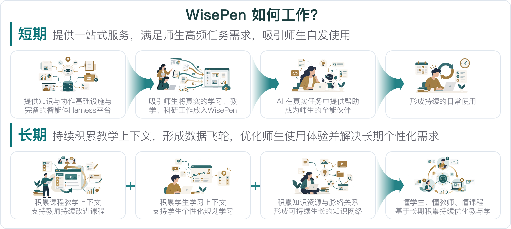
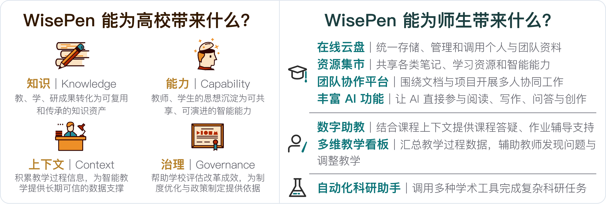
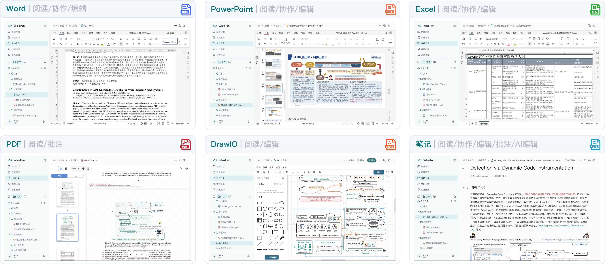
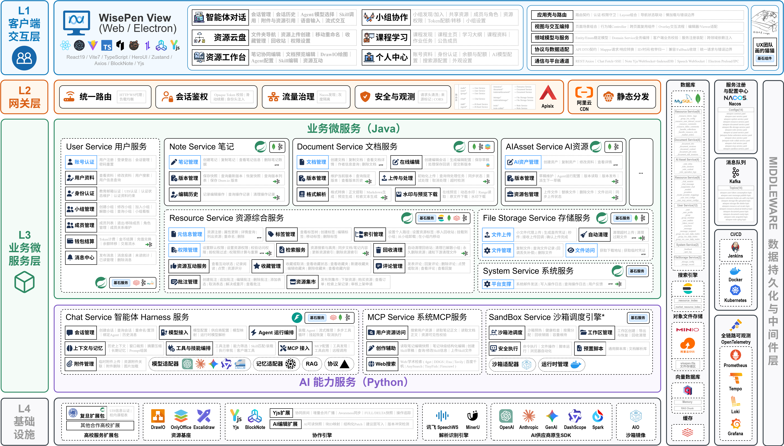
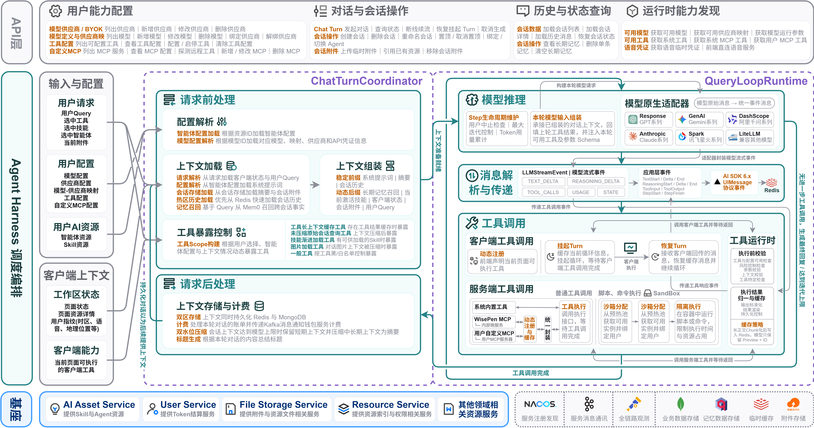

<div align="center">
  

  <p><strong>让每一次学习与思考，持续生长</strong></p>

  <p>面向高校教学、学习与科研全流程的开源知识与 Agent 协作平台</p>

  <p>
    
    <a href="#许可证"></a>
    <a href="https://github.com/Oriole-FDU/WisePen/issues"></a>
  </p>

  <p>
    <a href="https://home.wisepen.oriole.cn/">官方网站</a> | 
    <a href="https://wisepen.oriole.cn/">在线体验</a> | 
    <a href="https://document.wisepen.oriole.cn/">使用文档</a> | 
    <a href="#快速开始">快速开始</a> | 
    <a href="https://github.com/Oriole-FDU/WisePen/issues">问题反馈</a>
  </p>
</div>

---

## 项目概览

WisePen 是面向高校教学的开源 AI 原生平台，并延伸支持学生学习与科研工作。它以统一资源模型承载笔记、文档、文件、Skill 与 Agent，通过个人和团队空间、多人协作与权限系统组织知识生产和流动，并在此基础上提供能够理解资源、调用工具和执行任务的 Agent 运行能力。WisePen 支持高校私域部署，使核心系统、教学数据、知识资源和模型配置由学校自主掌握。

可以把 WisePen 理解为面向高校的 **“开源 Notion + 在线化、面向知识工作的 OpenCode”**：Notion 式知识空间负责内容组织与团队协作，Work Agent 则在权限边界内读取资源、调用 Skill 与工具、使用沙箱执行任务，并直接参与阅读、写作和知识生产。

<p align="center">
  
</p>

WisePen 不替代学籍、排课和成绩归档等教务管理系统。它的目标是在 AI 时代重新定义高校教学平台，逐步成为 Canvas 等传统 LMS 的开源、可私域部署替代方案，使知识协作与可执行 Agent 成为师生日常教学工作的主要入口，而不是在传统平台旁附加一个 AI 聊天框。

根仓库是 WisePen 的项目总入口，包含各系统组件、技术资料以及完整部署所需的 Deploy Kit。

## 快速开始

准备好 Docker 与 Docker Compose 后，可以启动 Deploy Kit：

```bash
git clone https://github.com/Oriole-FDU/WisePen.git
cd WisePen/wisepen-deploy-kit
docker compose up -d --build
```

访问 `http://localhost:8000`，按照页面向导填写域名、证书、基础设施和模型能力配置并执行部署。生产环境要求及高级配置见[部署文档](https://document.wisepen.oriole.cn/)和下方的[部署说明](#部署-wisepen)。

> [!NOTE]
> WisePen 当前处于 **Beta** 阶段，已经支持通过 Deploy Kit 完成自主部署。Beta 期间接口、配置项和部署流程仍可能随版本演进；升级前请查阅版本说明与部署文档。

## 设计背景

高校现有平台通常侧重签到、作业和成绩等管理记录，较少承载师生在提问、阅读、讨论和修改中形成的连续过程。WisePen 将这些活动组织在同一工作环境中，为基于课程和个人资料的 AI 能力提供上下文。

<p align="center">
  
</p>

## Demo：基于当前笔记的 AI 编辑

下面的录屏展示 Agent 读取当前笔记、调用 Skill，并根据用户要求分析和修改内容。该流程由 `wisepen-cloud-ai` 提供 Agent 运行能力，由 `wisepen-view` 提供内容编辑与交互界面。
<p align="center">
  <video src="./README/videos/wisepen-ai-write-video-CN.mp4" controls width="600"></video>
</p>

> 如果当前页面无法直接播放视频，可[打开 AI 辅助写作完整录屏](./README/videos/wisepen-ai-write-video-CN.mp4)。

更多功能与应用场景的演示视频正在准备中，敬请期待。

## 设计目标

WisePen 将师生日常产生的内容、过程和方法组织为四类可管理的数字资产：

- **知识（Knowledge）**：让教学、学习与科研成果成为可复用、可传承的知识资产；
- **上下文（Context）**：积累真实教学过程，为个性化教学与可信 AI 提供长期支撑；
- **能力（Capability）**：将教师和学生验证有效的方法沉淀为可共享、可演进的 Skill 与 Agent；
- **治理（Governance）**：在统一身份、资源和权限体系中管理知识流动，辅助高校评估与改进。

> [!NOTE]
> 下图同时展示 WisePen 当前能力与后续演进方向，其中部分能力正在建设中（Coming Soon），将在后续版本陆续提供。实际可用范围以在线平台、版本说明和下方的 Coming Soon 章节为准。

<p align="center">
  
</p>

## 能力

### 业务功能

| 能力 | 状态 | 说明 |
| --- | --- | --- |
| Note / DrawIO | Beta | Note 提供块式富文本编辑、公式与表格、评论批注、多人实时协作和 AI 内容编辑；DrawIO 用于在线创建和编辑流程图、架构图等科研与教学图示。 |
| Document / PDF | Beta | 支持 Word、PowerPoint、Excel 等 Office 文档的在线预览与编辑，以及 PDF 阅读和批注。 |
| WebApp | Alpha | WisePen 对下一代课件的探索。教师可以让 Agent 根据课程内容生成可直接运行的网页应用，用于概念演示、数据可视化、互动练习和轻量仿真，让课件从静态页面变成可交互的学习应用。 |
| Skill / Agent | Beta | 将 Skill 与 Agent 作为一等资源进行创建、配置、版本管理、发布与复用；提示词、工具选择和资源配置可以随其一同保存，并像其他资源一样分享给小组成员。 |
| Video / Audio | Coming Soon | 将视频和音频纳入统一资源体系，提供上传、处理、权限控制与在线播放能力。 |
| 问卷 | Coming Soon | 提供问卷设计、发布、回收和结果整理能力，并与小组和课程场景衔接。 |
| 资源管理与小组协作 | Beta | 所有资源类型共用统一的身份、目录、权限与生命周期管理。用户可以将个人资源挂载到小组而不转移所有权；小组角色控制管理操作，资源与栏目权限控制查看和编辑范围，评论、批注和多人实时编辑围绕具体资源展开。 |
| AI 内容协作 | Beta | AI 可以读取用户当前打开或授权引用的资源，结合对话上下文完成解释、问答、改写和内容生成，并将结果应用回实际工作内容。 |
| AI Agent | Beta | 支持多轮问答、当前资源问答、站内与互联网检索、网页阅读、文件解析、内容创作和资源读写；Agent 还可以调用 MCP 与自定义工具，并在隔离沙箱中执行 Shell 和代码任务。 |

<p align="center">
  
</p>

### 私域部署（Beta）

WisePen 支持通过 Deploy Kit 完成私域部署。部署者可以在可视化向导中配置域名、证书、基础设施、模型能力、持续交付与运维参数，并完成整套系统的安装和初始化。部署要求与操作步骤见[部署 WisePen](#部署-wisepen)。

### Coming Soon / 近景

以下能力正在开发中，尚不属于当前 Beta 版本的稳定能力：

| 方向 | 说明 |
| --- | --- |
| 资源市场 | 支持知识资源的发布、发现、预览和交换，促进校内知识流通。 |
| 课程空间增强 | 进一步组织课程资料、成员协作、教学任务和过程数据。 |
| RAG 能力演进 | 增强来源追溯、结构感知、上下文补全和多跳知识检索。 |
| 多智能体编排 | 根据任务组合不同 Agent、工具、知识与专业能力并协同执行。 |
| 科研工作流 | 扩展文献、论文、数据处理和学术工具等科研支持场景。 |

## 技术架构

WisePen 采用模块化服务架构，将用户、资源、权限、文件、文档、实时协作和 AI 能力组织为可以独立演进的组件。统一资源模型是连接知识基础设施与 Agent 平台的控制面：不同内容类型共享身份、组织、权限与生命周期能力，AI 则可以在授权范围内统一检索、读取和调用资源。

<p align="center">
  <a href="./README/imgs/wisepen-framework-CN.png">
    
  </a>
</p>

### Agent Harness

WisePen Harness 将模型、上下文、工具和隔离沙箱连接成完整的 Agent 运行环境。它支持 BYOK 与多模型接入，自动管理长对话上下文，并让 Agent 在权限范围内调用搜索、网页、文件、MCP 和 WisePen 资源工具，或进入隔离工作区执行 Shell 与代码任务。

<p align="center">
  <a href="./README/imgs/wisepen-harness-framework-CN.png">
    
  </a>
</p>

## 仓库地图

WisePen 根仓库是整个项目的统一入口，同时提供完整部署所需的 Deploy Kit。各组件围绕清晰边界独立演进：

| 目录 | 职责 | 主要技术 |
| --- | --- | --- |
| [`wisepen-view`](./wisepen-view) | WisePen Web 界面与用户交互 | React、Vite、TypeScript |
| [`wisepen-cloud`](./wisepen-cloud) | 用户、资源、权限、文档、文件等核心业务服务 | Java、Spring Cloud |
| [`wisepen-cloud-ai`](./wisepen-cloud-ai) | Chat、MCP、Sandbox 与 Agent 相关服务 | Python |
| [`wisepen-cloud-sidecar`](./wisepen-cloud-sidecar) | 基于 Yjs 的笔记实时协作服务 | Node.js、TypeScript、NestJS、Yjs |
| [`wisepen-cloud-gateway-deploy`](./wisepen-cloud-gateway-deploy) | 网关配置与部署支持 | Shell、容器配置 |
| [`wisepen-deploy-kit`](./wisepen-deploy-kit) | WisePen 部署配置向导与部署入口 | React、Python、Docker |
| [`wisepen-document`](./wisepen-document) | 用户、部署、开发、架构、案例与博客文档 | Docusaurus |

需要参与具体组件开发时，请进入对应目录查看项目配置和开发说明。完整使用、部署与运维文档见 [WisePen 文档站](https://document.wisepen.oriole.cn/)。

## 开发与贡献

WisePen 接受问题反馈、文档改进和代码贡献：

1. 在 [GitHub Issues](https://github.com/Oriole-FDU/WisePen/issues) 中搜索是否已有相关问题；
2. 根据上方仓库地图确认改动所属组件；
3. 阅读对应组件的开发说明与工程规范；
4. 在独立分支完成改动和验证，并通过 Pull Request 提交；
5. 在 PR 中说明问题、实现方式、验证结果以及尚未覆盖的场景。

功能建议和可复现的缺陷可以提交公开 Issue。安全漏洞请勿公开披露，请发送至 [support@oriole.cn](mailto:support@oriole.cn)。

## 部署 WisePen

WisePen Deploy Kit 提供完整的可视化部署流程，帮助部署者配置访问域名、证书、基础设施、模型能力、持续交付和运维参数，并完成 WisePen 各组件的安装与初始化。

### 前置条件

开始前请准备：

- **单机部署最低建议配置**：8 vCPU、32 GB 内存、200 GB 可用 SSD 存储；
- **推荐生产配置**：16 vCPU、64 GB 内存、500 GB 及以上 SSD 存储；
- 64 位 Linux 服务器，以及可用的 Docker 与 Docker Compose 环境；
- 用于访问 WisePen 的域名及相应 DNS 配置；
- HTTPS 证书或证书签发条件；
- 部署所需的存储、网络及其他基础设施信息；
- 按需准备模型和外部工具的 API 配置。

上述规格不包含本地大模型、GPU 文档解析或大规模 Agent Sandbox 的额外算力。启用这些能力时，请根据模型、并发量和任务负载单独规划 CPU、内存、存储与 GPU 资源。

### 启动 Deploy Kit

```bash
git clone https://github.com/Oriole-FDU/WisePen.git
cd WisePen/wisepen-deploy-kit
docker compose up -d --build
```

容器启动后访问：

```text
http://localhost:8000
```

按照页面向导完成配置确认并执行部署。生产环境要求、集群部署、升级与故障排查请参阅[部署文档](https://document.wisepen.oriole.cn/)。

## 文档与反馈

- **官方网站**：[home.wisepen.oriole.cn](https://home.wisepen.oriole.cn/)
- **在线平台**：[wisepen.oriole.cn](https://wisepen.oriole.cn/)
- **文档站**：[document.wisepen.oriole.cn](https://document.wisepen.oriole.cn/)
- **问题与建议**：[GitHub Issues](https://github.com/Oriole-FDU/WisePen/issues)
- **部署支持与项目合作**：[support@oriole.cn](mailto:support@oriole.cn)

提交 Issue 时，请尽量说明涉及的组件、使用版本、部署环境、复现步骤以及预期行为。安全漏洞请勿通过公开 Issue 披露，请通过联系邮箱与维护团队沟通。

## 许可证

WisePen 采用 **Business Source License 1.1（BSL 1.1）**：

- 允许个人、教育、学术研究及其他非商业用途部署、使用和修改 WisePen；
- 允许复制、创建衍生作品并在许可证约束下再分发；
- 商业或产生营收的生产使用需要另行取得商业授权；
- 每个版本将在发布四年后转换为 Apache License 2.0。

完整授权条件以仓库中的 LICENSE 文件为准。商业授权联系方式见下方“关于 WisePen”。

## 关于 WisePen

WisePen 由复旦大学 Oriole 团队发起，并由核心维护者与社区贡献者共同建设。项目持续关注知识协作、智能体软件工程以及 AI 在真实高校教学研场景中的长期应用。

项目发起者与核心维护者联系：[NeoSunJZ](mailto:jzsun24@m.fudan.edu.cn) / [Lonelycat](mailto:zhaojingyan719@gmail.com)。商业使用与授权事宜也可通过该邮箱联系。

<p align="left">
  
</p>
